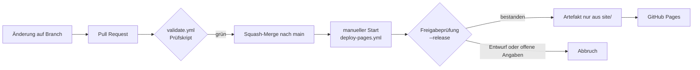

# Architektur

## Überblick

Die Website ist eine statische Seite aus HTML, CSS und wenig JavaScript ohne
Build-Schritt. GitHub Actions prüft den Inhalt von `site/` und liefert ihn nach
manueller Freigabe über GitHub Pages aus. Es gibt kein Backend, keine
Datenbank, keine Formulare und keine Abhängigkeiten von Drittanbietern zur
Laufzeit.

## Verzeichnisse

| Pfad | Zweck | wird ausgeliefert |
| --- | --- | --- |
| `site/*.html` | Seiten | ja |
| `site/assets/css/` | Stile | ja |
| `site/assets/js/` | Interaktionen | ja |
| `site/assets/images/` | Rastergrafiken (WebP, AVIF, PNG) | ja |
| `site/assets/icons/` | SVG-Symbole | ja |
| `site/assets/fonts/` | lokal ausgelieferte Schriften mit Lizenzdatei | ja |
| `site/assets/media/` | Videos und Animationsdaten | ja |
| `docs/`, `scripts/`, `.github/` | Entwicklung und Betrieb | nein |

## Entscheidung gegen einen Generator (vorläufig)

Für das Gerüst genügt reines HTML. Ein statischer Generator wie Astro wird erst
eingeführt, wenn die Website mehrere Seiten mit gemeinsamen Bausteinen oder
eine zweite Sprachfassung bekommt. Dann gilt: Der Generator erzeugt die Seiten
in einem Build-Schritt innerhalb dieses Repositorys, und das Ergebnis wird mit
demselben Prüfskript geprüft, bevor es ausgeliefert wird.

## Designsystem

Alle Gestaltungswerte stehen als CSS-Variablen in `site/assets/css/main.css`
unter `:root`. Komponenten verwenden nur die semantischen Variablen (`--bg`,
`--text`, `--accent` und so weiter), nicht die Grundfarben. So lässt sich die
spätere, freigegebene Palette an einer Stelle austauschen.

Die vorläufige Palette erreicht folgende Kontrastwerte (berechnet nach WCAG 2.x):

| Vordergrund | Hintergrund | Kontrast | zulässig für |
| --- | --- | --- | --- |
| `#14171c` Graphit | `#ffffff` Weiß | 17,96 : 1 | Fließtext |
| `#4a5260` Graphit hell | `#ffffff` Weiß | 7,87 : 1 | Nebentext |
| `#1d4ed8` Blau 700 | `#ffffff` Weiß | 6,70 : 1 | Links, Schaltflächen |
| `#ffffff` Weiß | `#1d4ed8` Blau 700 | 6,70 : 1 | Schrift auf Schaltflächen |
| `#2f6bff` Blau 500 | `#ffffff` Weiß | 4,50 : 1 | Grafik, große Schrift; kein Fließtext |
| `#ffffff` Weiß | `#0b1f3a` Marine | 16,52 : 1 | Text auf dunklen Flächen |
| `#3fd5e8` Cyan | `#0b1f3a` Marine | 9,36 : 1 | Akzente und Links auf dunklen Flächen |
| `#2f6bff` Blau 500 | `#0b1f3a` Marine | 3,67 : 1 | Grafik und Bedienelemente; kein Fließtext |

Cyan wird nie als Schrift auf hellem Grund verwendet.

## Zielwerte für Ladezeit und Umfang

Die Zielwerte gelten für die Startseite auf einem mittleren Mobilgerät und
werden vor jeder Freigabe mit Lighthouse geprüft.

| Messgröße | Ziel |
| --- | --- |
| Largest Contentful Paint | unter 2,0 s |
| Cumulative Layout Shift | unter 0,05 |
| Interaction to Next Paint | unter 200 ms |
| übertragene Daten bis zur ersten Darstellung | unter 300 KB |
| JavaScript gesamt (komprimiert) | unter 60 KB |
| Webschriften gesamt | unter 120 KB |
| Lighthouse Accessibility und Best Practices | je mindestens 95 |

## Sicherheitsköpfe

GitHub Pages erlaubt keine eigenen HTTP-Header. Eine Content-Security-Policy
lässt sich als `meta`-Element setzen, sobald die Seite stabil ist. Ohne
Inline-Skripte und ohne externe Quellen kann sie streng ausfallen, etwa
`default-src 'self'; img-src 'self' data:; object-src 'none'; base-uri 'self'`.
Die Direktive `frame-ancestors` wirkt im `meta`-Element nicht; ein Schutz gegen
Einbetten in fremde Rahmen ist auf GitHub Pages deshalb nicht möglich.
